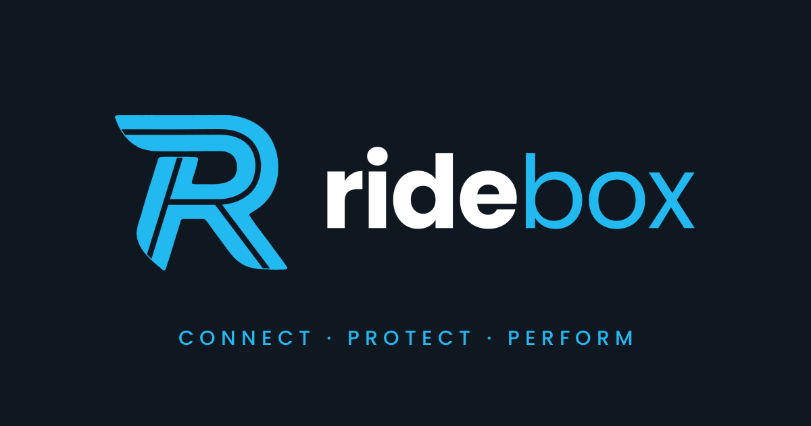

  

  <b>Telematics for motorcycles.</b> A small box on the bike, an app in the rider's pocket.

  <a href="https://ridebox.my">Website</a> ·
  <a href="mailto:hello@devhub.my">Contact</a>

---

### What RideBox does

| | |
|---|---|
| **Connect** | See where the bike is and how it is doing, live |
| **Protect** | Arm the box, get alerted on movement, find the bike again |
| **Perform** | Every ride recorded, with routes and summaries |

### For hardware partners

Building a device that should work with RideBox? We publish a device integration kit (protocol, payload rules, test tools) to partners. [Get in touch](mailto:hello@devhub.my) to request access.

### Security

Found a vulnerability? Please report it privately to [hello@devhub.my](mailto:hello@devhub.my) instead of opening a public issue.
